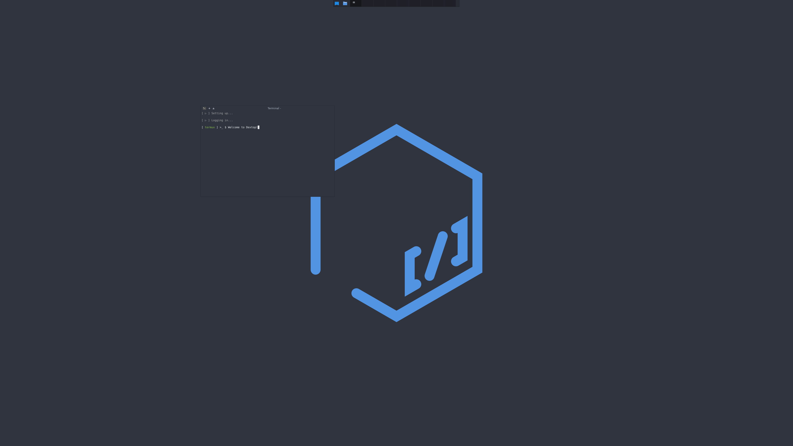
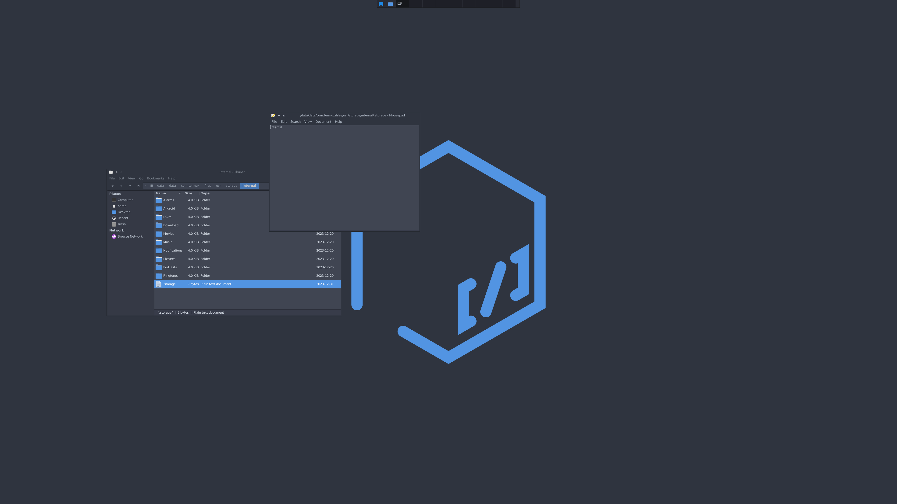
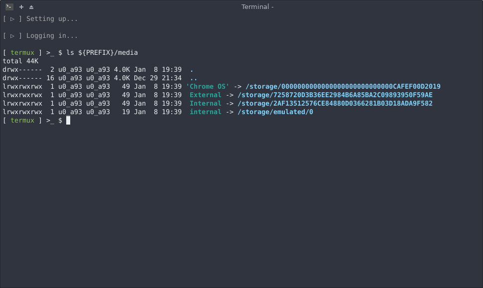
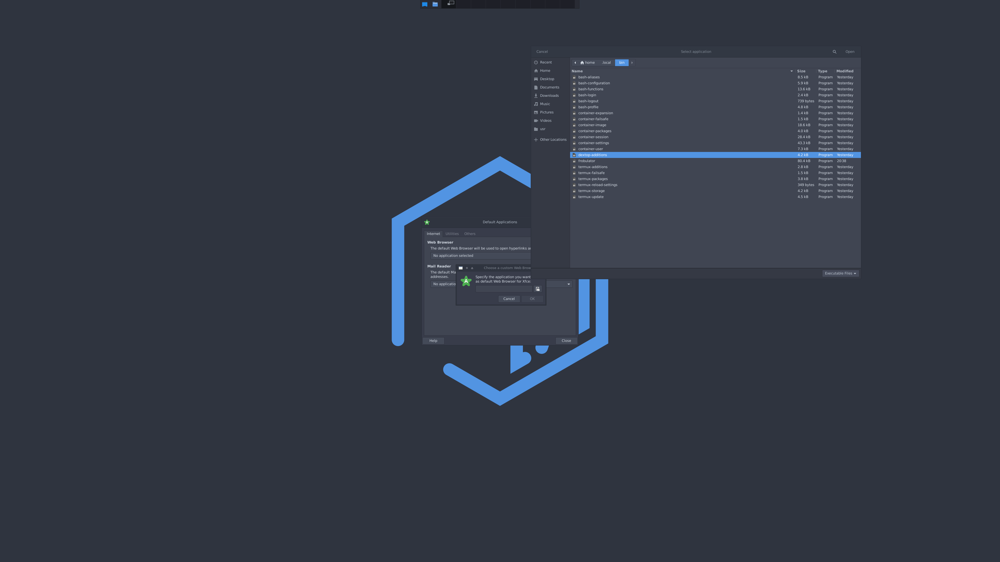

# Site

Every section of [dextop.app](https://dextop.app). `tools/dextop-site` builds the page from this file. Each `##` section starts with a comment that sets its page id, icon and heading, and its first paragraph is the lead. `- **Title.** text` lines become points and `1. **Title.** text` lines steps, a `<!-- table class -->` comment sets the class of the table below it, and a `<!-- gallery class -->` comment turns the images and video links below it into one gallery, the title of a single image setting its figure class. A `<!-- video -->` comment turns the link below it into a looping video. A `<!-- include name -->` comment places content read from the scripts, a paragraph made of links ending in › becomes a more link, and `@NAME@` placeholders are filled with counts read from the scripts.

## Overview

<!-- overview | orange | OVERVIEW // A LINUX WORKSTATION ON ANDROID -->

Dextop handles all the technical intricacies of a PRoot container so you can get right to work. It runs as a transient container system that talks to Android through the Termux shell to open viewers and applications as needed.



- **Three distributions.** Debian, Ubuntu and Fedora base images, stable and popular with large knowledge bases. Debian 13 (trixie) is the default.
- **Just like a PC.** The base image is expanded to a full system with a real user profile, a working home directory and sudo rights.
- **Desktop or console.** A complete XFCE desktop, the i3 window manager, or a console only setup for command line and programming work.
- **Native display.** The Termux:X11 display server at the device's native resolution and DPI, with VNC as an alternative display path.
- **Hardware acceleration.** 3D rendering offloaded to the device GPU through VirGL and the Gallium driver framework, on the PRoot container side.
- **Unified storage.** Internal and external media detected, labelled and linked, with one home directory shared by Termux and every container.
- **Android integration.** Links, mail, messages, camera and music are handed to native Android applications through the Activity Manager.
- **No root.** Everything runs in the Android user space through Termux and PRoot: the device is never rooted.
- **Safe by default.** The home directory is archived before setup, and the whole setup can be restored or purged again.
- **Help everywhere.** Every utility answers `-h` with its usage and options, all listed in the Commands section below.

### What it doesn't do

- **No services.** Dextop does not load services or backends, so applications that need them, such as Snap and snapd, do not run.
- **No hardware probes.** Features that need restricted system directories or hardware access only work on a rooted device.
- **Patched tools.** htop, kill, pgrep, pkill, ps and top are linked from their Termux builds for the limited access Android allows.

## Install

<!-- install | amber | INSTALL // ONE COMMAND, TEN MINUTES -->

Install Termux and Termux:X11, label your storage, and run one command. Back up your existing Termux setup first, following the Termux backup recommendations.

- **Device.** A modern Android device with a 64 bit ARM processor (ARM64 V8a), Android 7.0 or later. Android 11 to 13 can stop background processes: see the Phantom Process Killer.
- **Connection.** Medium to high speed internet for setup, updates and additional packages.
- **Space.** About 4 GB of free storage for Termux and the distribution container.
- **Peripherals.** A mouse, a keyboard, a power source for long sessions and, on phones, a monitor. Dextop is optimized for Samsung DeX.

### Prepare

1. **Get Termux from GitHub.** The Google Play Store packages are deprecated since November 2020: do not install them. Install the Termux and Termux:X11 APKs from their GitHub releases, and optionally Termux:API.
2. **Allow unknown apps.** Settings > Security and Privacy > Install unknown apps > Termux: the setup installs the companion applications for you.
3. **Label your storage.** In the storage you want as home, create a .storage file with a label, as shown below.

```
echo 'Home' > .storage
```

### Install

Open Termux and run the deployment script. Answer the user and distribution questions, press Allow for storage and Install for the add-ons, and the rest runs on its own in about 10 minutes.

```
curl -s -L run.dxtp.app > dextop && bash dextop
```

Choose another setup with an option: `bash dextop -e i3` for the i3 window manager, `bash dextop -c` for console access only, `t` or `n` for the Termux or container side alone.

### Use

| Prompt | Where | Command |
| --- | --- | --- |
| green termux | Termux system | `container-session -o` starts the Termux desktop |
| green termux | Termux system | `container-session -d` logs into the container |
| fuschia termux | Container system | `container-session -o` starts the container desktop |
| any | Logout | Ctrl+D or `exit` closes the session and goes up one level |

Opening Termux logs in and brings the graphical session up automatically. A recommended clean slate is a fresh Termux instance or profile, but Dextop also deploys over an existing setup.

[Download Termux from GitHub ›](https://github.com/termux/termux-app/releases)

## Setup

<!-- setup | yellow | SETUP // WHAT THE DEPLOYMENT SCRIPT DOES -->

`dextop` runs the whole setup in order, with Frobulator reporting every step. User information and distribution preferences are asked along the way, so stay attentive.

1. **Failsafe.** Refreshes the Termux repositories and packages so nothing is skipped on install.
2. **Backup.** Archives the home directory to `${PREFIX}/bkp` before anything changes.
3. **Preferences.** Links the Termux colors, font and properties.
4. **Utilities.** Downloads the Dextop utilities into `~/.local/bin`.
5. **Directories, additions and backgrounds.** Creates the setup directories, installs the Android handlers and the desktop backgrounds.
6. **Login options.** Turns on automatic session start and shutdown, and prepares the update and audio switches.
7. **Termux.** Installs the companion applications, links the storage and installs the Termux packages.
8. **Container.** Downloads the image, initializes it, expands it to a full system, installs its packages and creates your user.
9. **Desktop.** Links the shell files, file manager bookmarks, the i3 interface, icon themes and themes.
10. **Session.** Moves the deployment script into `~/.local/bin` and starts the first session.

Every step writes a checkpoint in `~/.dextop`, so running `bash dextop` again resumes where it stopped. The setup checkpoint is only written when every step succeeded. All prompts and outputs are logged to `${PREFIX}/var/log`.

### Files Dextop links

| File | Link |
| --- | --- |
| `~/.termux/colors.properties` | `~/.local/bin/termux-colors` |
| `~/.termux/font.ttf` | `~/.local/bin/termux-font` |
| `~/.termux/termux.properties` | `~/.local/bin/termux-properties` |
| `~/.bashrc` | `~/.local/bin/bash-configuration` |
| `~/.bash_aliases` | `~/.local/bin/bash-aliases` |
| `~/.bash_functions` | `~/.local/bin/bash-functions` |
| `~/.bash_login` | `~/.local/bin/bash-login` |
| `~/.bash_logout` | `~/.local/bin/bash-logout` |
| `~/.bash_profile` | `~/.local/bin/bash-profile` |

Dextop is Bash centric. All of these files can be customized and make a good base, but changes are at your own risk: bug reports stemming from modified scripts are closed.

## Images

<!-- distributions | lime | DISTRIBUTIONS // @DISTRIBUTIONS@ CONTAINER IMAGES -->

The container runs through PRoot with the Android system, storage and devices bound in, so it behaves like a normal Linux based system.

<!-- include images -->

- **Selection.** Without an image option the setup lists every supported image to pick by number. `container-image -s` shows the list.
- **Architecture.** The processor is checked against the image architectures before anything is downloaded.
- **Matching sources.** Container apt sources follow each release: archive, ports and non-free-firmware.
- **Locale.** Setup runs in C.UTF-8 and initializes the container locale. Sessions fall back to C.UTF-8 when the chosen locale is missing.
- **Hostname.** The container is called `dextop` by default, not after Android. Set another with `container-user -n`.
- **Several containers.** Containers live under `${PREFIX}/cnt/distribution/version`. `container-session -d` picks one, or lists them all to choose from.

## Sessions

<!-- sessions | green | SESSIONS // DESKTOPS ON TERMUX:X11 OR VNC -->

`container-session` starts and stops the graphical session, on Termux or inside the container. It is just like running a virtual machine on a computer and looking at it through a viewer.

| Command | Does |
| --- | --- |
| `container-session -o` | Starts the session on Termux:X11, the default display |
| `container-session -o vnc` | Starts the session on x11vnc and opens the VNC viewer |
| `container-session -x` | Exits the session and stops the display server |
| `container-session -u [User Name]` | Logs in as another container user |
| `container-session -d [Directory]` | Logs into the container in that directory |
| `container-session -f [Application]` | Starts the session focused on one application |
| `container-session -l` | Lists the display server information and parameters |
| `container-session -p vnc` | Generates the VNC session password |

- **Termux or container.** The green prompt is the Termux system, the fuschia prompt the container. Each has its own desktop session.
- **User termux.** The default container user is `termux`. Add more with `container-user -u` and change passwords with `container-user -p`.
- **First login.** The first container login sets up the keyboard layout, locales and timezone once.
- **VNC resolution.** The VNC session asks for a resolution once and keeps it in `~/.vnc/selection`. Remove that file to choose again.
- **VNC viewers.** Remotix, RealVNC VNC Viewer or bVNC, with full screen or immersive modes.
- **Logout.** Ctrl+D, `logout` or `exit` stops the session and goes back to the Termux shell, or to the Android home screen.

### Display and data paths

| Path | Route |
| --- | --- |
| Display | Container ► X Server ► Termux:X11 ► Display |
| Display | Container ► x11vnc ► VNC Viewer ► Display |
| Acceleration | Container ► VirGL ► Graphics ► GPU |
| Storage | Storage ► /storage ► proot bind ► Container |
| Storage | Storage ► /storage ► ${PREFIX}/media/link ► Home |
| Launch | Dextop ► termux-am ► Android Activities ► Termux:X11 / VNC Viewer |

XFCE compositing stays off: within Android's user space policy it costs performance and causes tearing.

## Storage

<!-- storage | emerald | STORAGE // ONE HOME FOR EVERY SYSTEM -->

`termux-storage` asks for the storage permission, then links internal and external media for system wide access. Create the .storage labels before setup for recognizable names.

<!-- gallery two -->




- **Detection.** Mounts under /storage are read from /proc/mounts, which avoids the /storage access limits of Android 11 and later, and filtered for SD cards, external drives and Chrome OS UUID mounts.
- **Labels.** Each mount is linked under `${PREFIX}/media` by the label in its .storage file: `echo internal > /storage/self/primary/.storage` gives `internal -> /storage/self/primary`.
- **No label.** Unlabelled mounts are linked by their own names or UUIDs.
- **Home.** A storage labelled `Home` holds the standard directories, linked into the home directory shared by Termux and every container.
- **Chrome OS.** Add a .storage file containing `Home` under My files so the links find your directories in every container.
- **Bookmarks.** Every mount is added to the file manager bookmarks with its label.

## Additions

<!-- additions | teal | ADDITIONS // ANDROID APPLICATIONS FROM THE DESKTOP -->

`dextop-additions` hands desktop requests to the Android Activity Manager, which opens the matching Android application for you. Dextop only loads applications as needed, keeping the device smooth.



<!-- include additions -->

- **Slim system.** Music, mail, browsing and games run best in native Android applications, with hardware acceleration and the device features.
- **Default applications.** The desktop opens links, mail and files in Android applications through the mimetype handles.
- **Audio.** PulseAudio playback works but is heavy on the battery and processor. It is off by default.

## Switches

<!-- switches | cyan | SWITCHES // LOGIN, LOGOUT, UPDATES AND AUDIO -->

Dextop keeps its choices as small files in `~/.dextop`. Write the keyword in a file to turn a switch on, empty it to turn it off. Automatic login and logout are on after setup.

| Switch | File in ~/.dextop | On | Off |
| --- | --- | --- | --- |
| Automatic session start on login | `dextop-login` | `echo login > ~/.dextop/dextop-login` | `echo '' > ~/.dextop/dextop-login` |
| Session and display shutdown on exit | `dextop-logout` | `echo logout > ~/.dextop/dextop-logout` | `echo '' > ~/.dextop/dextop-logout` |
| Utility updates on login | `dextop-update` | `echo update > ~/.dextop/dextop-update` | `echo '' > ~/.dextop/dextop-update` |
| Audio playback on login | `dextop-audio` | `echo audio > ~/.dextop/dextop-audio` | `echo '' > ~/.dextop/dextop-audio` |

- **Environment.** `dextop-environment` keeps the desktop chosen at setup: xfce, i3 or console.
- **Session.** `dextop-session` keeps the session command: xfce4-session, i3 or console.
- **Container.** `dextop-container` keeps the container directory, `${PREFIX}/cnt/debian/13` by default.
- **Login count.** `dextop-ticker` counts the logins shown on the welcome message.
- **Checkpoints.** One `dextop-...-checkpoint` file per setup step. Remove `~/.dextop` to run the whole setup again.

## Packages

<!-- packages | sky | PACKAGES // @PACKAGES@ PACKAGES BY GROUP -->

`termux-packages` and `container-packages` install these groups, read straight from the scripts. The container installs them under their Debian and Ubuntu or Fedora names.

<!-- include groups -->

### Termux add-ons

`termux-addons` installs the Termux companion applications. Remove any earlier version first so no conflicting package signatures are inherited.

<!-- include addons -->

- **By desktop.** Console installs the base groups only. i3 adds the i3 and i3 add-on groups, XFCE the XFCE, font and theme groups and Papirus-Dark icons.
- **Removed.** ibus, snap and xterm are purged from the container.

## Maintenance

<!-- maintenance | blue | MAINTENANCE // UPDATE, BACK UP, RESTORE AND PURGE -->

Dextop updates itself and its utilities from the latest release, and keeps your home directory safe with dated backups.

### Update

Get the latest deployment script first, then update what you need. A wrong utility name lists every available one.

```
curl -s -L run.dxtp.app > "${HOME}"/.local/bin/dextop
bash dextop -u all
bash dextop -u utility all
bash dextop -u utility [Utility Name]
bash dextop -u shell
```

`termux-update` checks the Termux application itself against GitHub or F-Droid with `-g` or `-f` and offers the update.

### Back up, restore and purge

| Command | Does |
| --- | --- |
| `bash dextop -b` | Archives the home directory to `${PREFIX}/bkp/dextop-backup-YYYY-MM-DD-HH-MM-SS.tar.gz` |
| `bash dextop -r` | Restores the latest backup |
| `bash dextop -r earliest` | Restores the backup taken before setup, clearing the links and files setup made |
| `bash dextop -r [name]` | Restores a backup by its file name |
| `bash dextop -p` | Removes Dextop and everything its setup installed, after confirmation, then offers the earliest backup |

Backups are kept outside the home directory, so no backup ever holds another, and purge keeps them.

### Issues

- **Missing packages.** Spotty Termux repositories can skip packages. Run `bash dextop` again: it resumes from its checkpoints.
- **Start over.** Remove `~/.dextop` to reset the setup checkpoints without wiping Termux.
- **Broken script.** A slow or failed download can corrupt the deployment script: fetch it again and run `bash dextop -u utility all`.
- **Logs.** Attach the files from `${PREFIX}/var/log` to bug reports.

[Submit a bug report or feature request ›](https://github.com/nathaneltitane/dextop/issues)

## Commands

<!-- commands | indigo | COMMANDS // EVERY UTILITY AND OPTION -->

The help of all @UTILITIES@ Dextop utilities, read from the scripts themselves: @OPTIONS@ options with their values and defaults. The marked letter is the short option. Search them, or pick a group.

<!-- include commands -->

## News

<!-- news | violet | NEWS // LATEST CHANGES -->

The latest release notices from the Dextop repository.

<!-- include notice -->

[Read every notice ›](https://github.com/nathaneltitane/dextop/blob/main/NOTICE.md)

